# JOBSHEET 8 - PERULANGAN 2

**Identitas Mahasiswa:**
* **Nama:** Saefira Bahari
* **NIM:** 264107020247
* **Kelas / No. Presensi:** TI-1D/26

---

## 1: TUJUAN PRAKTIKUM

Berikut adalah tujuan pelaksanaan praktikum pada bab ini:

1. Memahami konsep dan alur perulangan bersarang.
2. Mengenal sintaks perulangan bersarang.
3. Menerapkan perulangan bersarang untuk menyelesaikan studi kasus sederhana.

---

## 2: HASIL PERCOBAAN & ANALISIS

### 2.1 Percobaan 1: Review Perulangan 1

Percobaan ini meninjau perulangan `for` untuk mencetak karakter atau bilangan berulang. Program berikut merupakan hasil modifikasi untuk mencetak bilangan ganjil positif sampai dengan `n`.

#### 2.1.1 Kode Program Java

```java
import java.util.Scanner;

public class star26 {
    public static void main(String[] args) {
        Scanner sc = new Scanner(System.in);
        System.out.print("Masukkan nilai n = ");
        int n = sc.nextInt();
        for (int i = 1; i <= n; i += 2) {
            System.out.print(i + " ");
        }
        System.out.println();
        sc.close();
    }
}
```

#### 2.1.2 Hasil Running / Screenshot Output

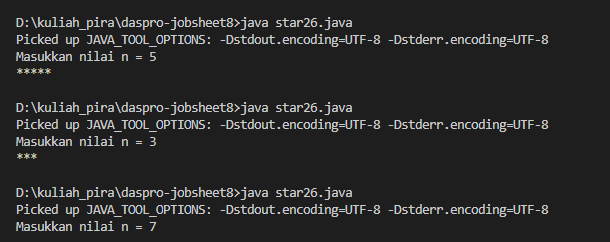

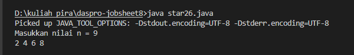

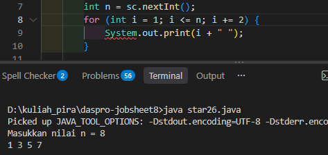

#### 2.1.3 Jawaban Pertanyaan / Pertanyaan Refleksi

* **Pertanyaan 1:** Jika inisialisasi `i = 1` diubah menjadi `i = 0` tanpa mengubah kondisi, berapa karakter `*` yang tercetak ketika `n = 5`?  
  * **Jawab:** Tercetak 6 karakter `*`, karena nilai `i` adalah 0, 1, 2, 3, 4, dan 5.
* **Pertanyaan 2:** Jika kondisi `i <= n` diganti menjadi `i < n`, berapa kali perulangan dijalankan saat `n = 5`?  
  * **Jawab:** Perulangan dijalankan 4 kali, untuk nilai `i` dari 1 sampai 4. Nilai 5 tidak ikut karena kondisi harus kurang dari 5.
* **Pertanyaan 3:** Apa output perulangan `for (int i = 2; i <= n; i += 2)` jika `n = 9`? Bagaimana mengubahnya agar mencetak bilangan ganjil positif?
  * **Jawab:** Outputnya `2 4 6 8`. Untuk mencetak bilangan ganjil positif, mulai dari `i = 1` dan gunakan `i += 2`, sehingga outputnya `1 3 5 7 9`.
* **Pertanyaan 4:** Mengapa perubahan increment `i++` menjadi `i--` dengan kondisi tetap `i <= n` membuat perulangan tidak berhenti untuk `n` positif?
  * **Jawab:** Nilai `i` akan terus berkurang dan tetap kurang dari atau sama dengan `n`. Karena kondisinya selalu benar, perulangan terus berjalan.

---

### 2.2 Percobaan 2: Pola Bintang Persegi Panjang (Nested FOR)

Percobaan ini menggunakan dua perulangan `for` untuk mencetak persegi panjang. Perulangan luar mengatur baris, sedangkan perulangan dalam mengatur karakter pada setiap baris. Karakter pada program akhir diubah menjadi `#`.

#### 2.2.1 Kode Program Java

```java
import java.util.Scanner;

public class rectangle26 {
    public static void main(String[] args) {
        Scanner sc = new Scanner(System.in);

        System.out.print("Masukkan jumlah baris: ");
        int baris = sc.nextInt();
        System.out.print("Masukkan jumlah kolom: ");
        int kolom = sc.nextInt();

        for (int i = 1; i <= baris; i++) {
            for (int j = 1; j <= kolom; j++) {
                System.out.print("#");
            }
            System.out.println();
        }
        sc.close();
    }
}
```

#### 2.2.2 Hasil Running / Screenshot Output

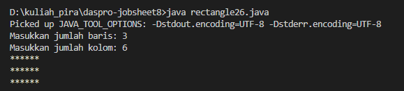

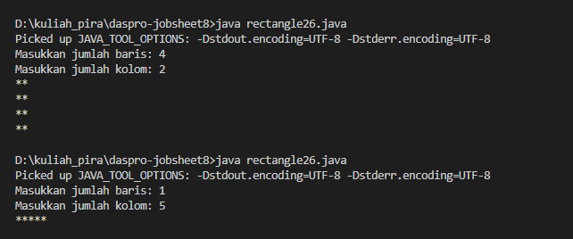

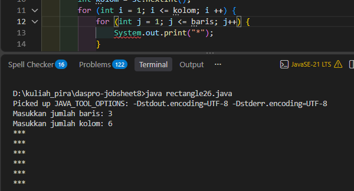

#### 2.2.3 Jawaban Pertanyaan / Pertanyaan Refleksi

* **Pertanyaan 1:** Tentukan fungsi variabel `i` dan `j`.
  * **Jawab:** `i` mengatur baris yang dicetak, sedangkan `j` mengatur kolom atau karakter pada setiap baris.
* **Pertanyaan 2:** Berapa kali perulangan dan `print("*")` dijalankan untuk `baris = 4` dan `kolom = 7`?
  * **Jawab:** Perulangan luar berjalan 4 kali. Perulangan dalam berjalan 7 kali pada setiap baris, sehingga perintah cetak dijalankan sebanyak `4 × 7 = 28` kali.
* **Pertanyaan 3:** Apa yang terjadi jika batas perulangan luar dan dalam ditukar untuk `baris = 3` dan `kolom = 6`?
  * **Jawab:** Program mencetak 6 baris dengan 3 karakter pada setiap baris. Jumlah karakternya tetap 18, tetapi bentuk persegi panjangnya menjadi lebih tinggi dan lebih sempit.
* **Pertanyaan 4:** Apa akibat menghapus `System.out.println()` setelah inner loop?
  * **Jawab:** Semua karakter tercetak sambung dalam satu baris karena program tidak berpindah baris setelah menyelesaikan satu baris.
* **Pertanyaan 5:** Bagaimana mengubah karakter bintang menjadi `#`?
  * **Jawab:** Ganti `System.out.print("*");` menjadi `System.out.print("#");`.

---

### 2.3 Percobaan 3: Debugging Bintang Segitiga (Nested WHILE)

Percobaan ini memperbaiki perulangan `while` bersarang agar mencetak segitiga naik, lalu menambahkan segitiga terbalik. Variabel `i` mengatur baris dan variabel `j` menghitung karakter pada baris tersebut.

#### 2.3.1 Kode Program Java

```java
import java.util.Scanner;

public class TriangleNoAbsen {
    public static void main(String[] args) {
        Scanner sc = new Scanner(System.in);
        System.out.print("Masukkan nilai n = ");
        int n = sc.nextInt();
        int i = 1;
        while (i <= n) {
            int j = 0;
            while (j < i) {
                System.out.print("*");
                j++;
            }
            System.out.println();
            i++;
        }
        System.out.println("--------------");
        i = n;
        while (i >= 1) {
            int j = 0;
            while (j < i) {
                System.out.print("*");
                j++;
            }
            System.out.println();
            i--;
        }
        sc.close();
    }
}
```

#### 2.3.2 Hasil Running / Screenshot Output

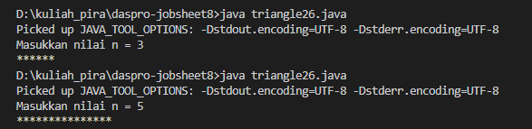

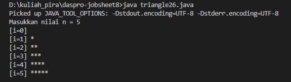

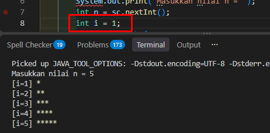

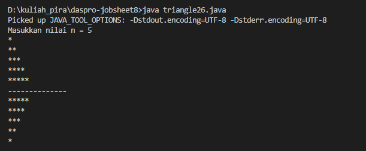

#### 2.3.3 Jawaban Pertanyaan / Pertanyaan Refleksi

* **Pertanyaan 1:** Sebutkan ketidaksesuaian output awal dan minimal dua perbaikan yang diperlukan.
  * **Jawab:** Kode awal memulai `i` dari 0 sehingga menghasilkan baris kosong, dan tidak memiliki `System.out.println()` setelah inner loop sehingga semua bintang tercetak pada satu baris. Ubah nilai awal `i` menjadi 1 dan tambahkan `System.out.println()` setelah inner loop.
* **Pertanyaan 2:** Jelaskan peran `i` dan `j`. Mengapa `j` harus diinisialisasi kembali ke 0 pada setiap baris?
  * **Jawab:** `i` menentukan baris dan jumlah bintang pada baris itu. `j` menghitung bintang yang dicetak. `j` harus di-reset ke 0 agar penghitungan dimulai kembali pada setiap baris; jika tidak, jumlah bintang pada baris berikutnya menjadi tidak sesuai.
* **Pertanyaan 3:** Bagaimana perubahan outer loop untuk membentuk segitiga terbalik?
  * **Jawab:** Mulai dengan `i = n`, gunakan kondisi `i >= 1`, lalu kurangi `i` dengan `i--` setiap iterasi. Dengan begitu, jumlah bintang berkurang satu pada setiap baris.

---

### 2.4 Percobaan 4: Studi Kasus Nilai Tugas Proyek Kelompok

Program menerima nilai dari beberapa penilai untuk setiap kelompok, menghitung rata-rata kelompok, lalu menentukan kelompok dengan rata-rata tertinggi. Perulangan `while`, `for`, dan `do-while` digunakan untuk mengulang kelompok, penilai, dan input nilai yang tidak valid.

#### 2.4.1 Kode Program Java

```java
import java.util.Scanner;

public class nilaiKelompok26 {
    public static void main(String[] args) {
        Scanner sc = new Scanner(System.in);
        System.out.print("Masukkan jumlah kelompok : ");
        int jumlahKelompok = sc.nextInt();
        System.out.print("Masukkan jumlah penilai  : ");
        int jumlahPenilai = sc.nextInt();

        if (jumlahKelompok <= 0 || jumlahPenilai <= 0) {
            System.out.println("Jumlah kelompok dan penilai harus > 0.");
            sc.close();
            return;
        }

        int nomorKelompok = 1;
        double rataTertinggi = -1;
        int kelompokTerbaik = 0;

        System.out.println();
        while (nomorKelompok <= jumlahKelompok) {
            System.out.println("Kelompok " + nomorKelompok);
            double totalNilai = 0;
            for (int j = 1; j <= jumlahPenilai; j++) {
                int nilai;
                do {
                    System.out.print("  Nilai dari Penilai " + j + ": ");
                    nilai = sc.nextInt();
                    if (nilai < 0 || nilai > 100) {
                        System.out.println("  Nilai harus 0-100. Ulangi input!");
                    }
                } while (nilai < 0 || nilai > 100);
                totalNilai += nilai;
            }
            double rataNilai = totalNilai / jumlahPenilai;
            System.out.println("Kelompok " + nomorKelompok + ": nilai rata-rata = " + rataNilai);
            System.out.println();
            if (rataNilai > rataTertinggi) {
                rataTertinggi = rataNilai;
                kelompokTerbaik = nomorKelompok;
            }
            nomorKelompok++;
        }
        System.out.println("==============================");
        System.out.println();
        System.out.println("Kelompok terbaik    : " + kelompokTerbaik);
        System.out.println("Rata-rata tertinggi : " + rataTertinggi);
        sc.close();
    }
}
```

#### 2.4.2 Hasil Running / Screenshot Output

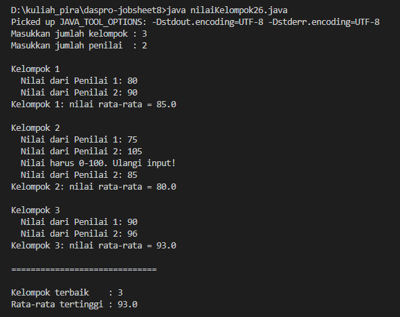

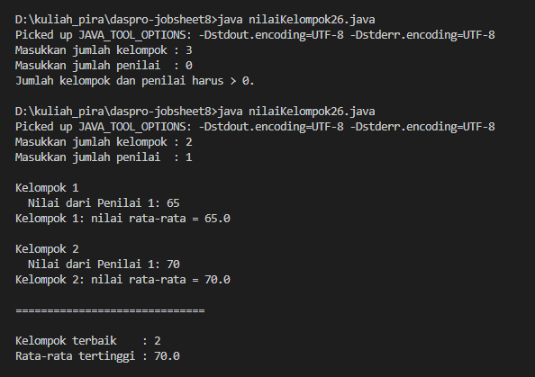

#### 2.4.3 Jawaban Pertanyaan / Pertanyaan Refleksi

* **Pertanyaan 1:** Mengapa `totalNilai` perlu di-reset pada setiap kelompok, sedangkan `rataTertinggi` tidak?
  * **Jawab:** `totalNilai` hanya menjumlahkan nilai penilai untuk satu kelompok, jadi harus dimulai kembali dari 0 pada kelompok berikutnya. `rataTertinggi` menyimpan perbandingan semua kelompok, sehingga tidak boleh di-reset.
* **Pertanyaan 2:** Untuk 3 kelompok dan 2 penilai, berapa kali badan perulangan `for` dijalankan?
  * **Jawab:** 6 kali, yaitu 2 penilai untuk masing-masing dari 3 kelompok.
* **Pertanyaan 3:** Apa yang terjadi jika `totalNilai` bertipe `int` dan rata-rata dihitung dengan pembagian dua bilangan bulat?
  * **Jawab:** Bagian desimal akan dibuang. Misalnya nilai 80 dan 81 memiliki jumlah 161; `161 / 2` menghasilkan 80, bukan 80.5.
* **Pertanyaan 4:** Mengapa `rataTertinggi` diberi nilai awal -1, bukan 0?
  * **Jawab:** Agar rata-rata 0 tetap bisa menjadi nilai tertinggi dan kelompoknya tercatat. Jika nilai awalnya 0 dan satu kelompok mendapat nilai 0, syarat `rataNilai > rataTertinggi` tidak terpenuhi, sehingga kelompok terbaik tidak diperbarui.
* **Pertanyaan 5:** Sebutkan jenis dan peran tiga tingkat perulangan dalam program.
  * **Jawab:** `while` luar mengulang kelompok, `for` mengulang penilai di setiap kelompok, dan `do-while` meminta ulang nilai penilai jika nilainya kurang dari 0 atau lebih dari 100.

---

## 3: TUGAS MANDIRI

Berikut adalah tugas mandiri yang dikerjakan pada Jobsheet ini:

- [x] **Tugas 1:** Membuat pola bilangan bertingkat dan menghitung banyak angka yang dicetak.
- [x] **Tugas 2:** Membuat tabel perkalian dan menjumlahkan seluruh hasilnya.
- [x] **Tugas 3:** Merekap jumlah pelanggan dan barang dari beberapa toko.

### 3.1 Tugas 1: Pola Bilangan Bertingkat

Program mencetak bilangan dari 1 sampai nomor baris. Setelah pola selesai, program menampilkan banyaknya angka yang telah dicetak.

#### 3.1.1 Kode Program Java

```java
import java.util.Scanner;

public class tugas1 {
    public static void main(String[] args) {
        Scanner sc = new Scanner(System.in);
        System.out.print("Masukkan nilai n = ");
        int n = sc.nextInt();
        int totalAngkaTercetak = 0;
        for (int i = 1; i <= n; i++) {
            for (int j = 0; j < i; j++) {
                System.out.print(j + 1);
                if (j < i - 1) {
                    System.out.print(" ");
                }
                totalAngkaTercetak++;
            }
            System.out.println();
        }
        System.out.println("Total angka tercetak: " + totalAngkaTercetak);
        sc.close();
    }
}
```

#### 3.1.2 Hasil Running / Screenshot Output

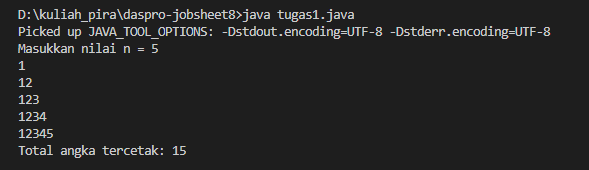

#### 3.1.3 Analisis

Perulangan luar menentukan nomor baris. Perulangan dalam mencetak bilangan dari 1 sampai nomor baris dan menambah penghitung setiap kali satu angka dicetak. Untuk `n = 5`, pola berisi `1 + 2 + 3 + 4 + 5 = 15` angka.

### 3.2 Tugas 2: Tabel Perkalian

Program menampilkan tabel perkalian berukuran `n × n`. Nilai `n` harus minimal 3. Setiap sel merupakan hasil kali nomor baris dan nomor kolom.

#### 3.2.1 Kode Program Java

```java
import java.util.Scanner;

public class tugas2 {
    public static void main(String[] args) {
        Scanner sc = new Scanner(System.in);
        System.out.print("Masukkan nilai n (minimal 3): ");
        int n = sc.nextInt();
        if (n < 3) {
            System.out.println("Nilai n harus minimal 3.");
            sc.close();
            return;
        }
        int lebar = String.valueOf((long) n * n).length();
        long total = 0;
        for (int baris = 1; baris <= n; baris++) {
            for (int kolom = 1; kolom <= n; kolom++) {
                long hasil = (long) baris * kolom;
                System.out.printf("%" + lebar + "d ", hasil);
                total += hasil;
            }
            System.out.println();
        }
        System.out.println("Jumlah seluruh angka pada tabel: " + total);
        sc.close();
    }
}
```

#### 3.2.2 Hasil Running / Screenshot Output

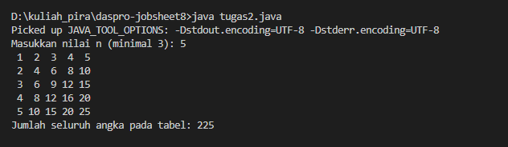

#### 3.2.3 Analisis

Perulangan bersarang mengisi setiap baris dan kolom dengan hasil perkalian. Lebar angka disesuaikan dengan hasil terbesar agar kolom tabel rapi. Untuk `n = 4`, jumlah semua hasil perkalian pada tabel adalah 100.

### 3.3 Tugas 3: Rekap Penjualan Beberapa Toko

Program mencatat jumlah pelanggan dan jumlah barang yang dibeli pada setiap toko. Data pelanggan dan barang dijumlahkan saat dibaca, tanpa menyimpan tiap data satu per satu. Jika beberapa toko memiliki jumlah barang tertinggi yang sama, toko bernomor paling kecil dipilih.

#### 3.3.1 Kode Program Java

```java
import java.util.Scanner;

public class tugas3 {
    public static void main(String[] args) {
        Scanner sc = new Scanner(System.in);
        int jumlahToko;
        do {
            System.out.print("Masukkan jumlah toko (minimal 1): ");
            jumlahToko = sc.nextInt();
        } while (jumlahToko < 1);

        int totalBarangSemuaToko = 0;
        int tokoTerbanyak = 1;
        int barangTerbanyak = -1;

        for (int toko = 1; toko <= jumlahToko; toko++) {
            int jumlahPelanggan;
            do {
                System.out.print("Masukkan jumlah pelanggan Toko " + toko + ": ");
                jumlahPelanggan = sc.nextInt();
            } while (jumlahPelanggan < 0);

            int totalBarangToko = 0;
            for (int pelanggan = 1; pelanggan <= jumlahPelanggan; pelanggan++) {
                int jumlahBarang;
                do {
                    System.out.print("  Barang yang dibeli Pelanggan " + pelanggan + ": ");
                    jumlahBarang = sc.nextInt();
                } while (jumlahBarang < 0);

                totalBarangToko += jumlahBarang;
            }

            System.out.println("Toko " + toko + " - pelanggan: " + jumlahPelanggan
                    + ", total barang: " + totalBarangToko);

            totalBarangSemuaToko += totalBarangToko;
            if (totalBarangToko > barangTerbanyak) {
                barangTerbanyak = totalBarangToko;
                tokoTerbanyak = toko;
            }
        }

        System.out.println("Total barang seluruh toko: " + totalBarangSemuaToko);
        System.out.println("Toko dengan barang terbanyak: " + tokoTerbanyak);
        sc.close();
    }
}
```

#### 3.3.2 Hasil Running / Screenshot Output

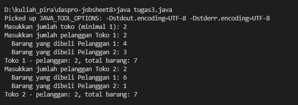

#### 3.3.3 Analisis

Perulangan luar memproses setiap toko. Perulangan berikutnya memproses pelanggan dan menjumlahkan barang yang dibeli. Untuk contoh pada jobsheet, Toko 1 memiliki 5 barang dan Toko 2 memiliki 7 barang, sehingga total seluruh toko adalah 12 dan toko dengan barang terbanyak adalah Toko 2.

---

## 4: KESIMPULAN

Perulangan bersarang menjalankan satu perulangan di dalam perulangan lain. Pola persegi panjang dan segitiga menunjukkan bahwa perulangan luar dapat mengatur baris, sementara perulangan dalam mengatur isi setiap baris. Pada studi kasus nilai kelompok dan rekap toko, beberapa tingkat perulangan membantu memproses data bertingkat serta menghitung total dan nilai tertinggi tanpa menyimpan semua data satu per satu.
